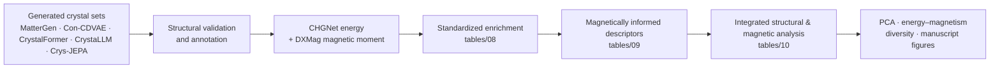

# MagGenBench

MagGenBench is a scientific benchmark repository for analyzing inorganic crystal structures produced by generative models, with emphasis on magnetic-material discovery signals.

The repository goal is to be self-explanatory and reproducible: reusable code lives under `src/mvpipeline`, active run recipes have semantic locations under `runs/`, generated artifacts are separated from source, and the public execution surface is intentionally small.




## Evaluated Generative Models

MagGenBench currently evaluates five generative model families across
ten accepted downstream cohorts.

| Model | Evaluated variants |
| --- | --- |
| MatterGen | Base, Fine-tuned |
| Con-CDVAE | Base, Fine-tuned |
| CrystalFormer | Base, Fine-tuned |
| CrystaLLM | Base, Fine-tuned |
| Crys-JEPA | Base, Refined |

The integrated manuscript comparison includes **12,281 QC-retained
structures** across these ten cohorts. CrystalFormer Fine-tuned
contributes 1,380 retained structures and CrystaLLM Fine-tuned
contributes 217.

The historical eight-cohort table at
`tables/10_analysis_v2_magnetic/analysis_v2_magnetic.csv`
remains frozen for reproducibility. The publication figure sources
for the updated comparison are stored in
`tables/figure_sources/`.

### Manuscript figure mapping

| Manuscript figure | Content |
| --- | --- |
| Figure 1 | Benchmark pipeline |
| Figure 2 | Structural quality control |
| Figure 3 | Magnetic-domain descriptors |
| Figure 4 | Magnetic-reference screening and DFT validation |
| Figure 5 | Energy–magnetism landscape |
| Figure 6 | Compound classes and chemical diversity |
| Figure 7 | Five metrics; S1 Pareto, rank stability and Top-5 frequency |

Figure 4 is `paper/figures/fig04_magnetic_reference_dft.pdf`. Its publication
design preserves the statistical vectors of the original collaborator PDF,
`Figure_MP_only_generator_benchmark.pdf`, with updated labels, layout and styling.
Panels A-C use the MP-only reference setup without MAGNDATA. Panel D contains
previously obtained DFT results and is not an independent validation of A-C.
See [reproduction and numerical limitations](docs/figures/figure4_reproduction.md)
and the [caption](paper/figures/figure_captions.md#figure-4). The MP-only plotting source is
`filter/scripts/plot_mp_only_publication.py`; the selected vector-preserving design
is reproduced by `scripts/illustrations/restyle_figure4_original_vectors.py`.
The archived [descriptor-space PCA figure](paper/figures/legacy/descriptor_space_pca.pdf)
is retained for provenance under `paper/figures/legacy/`.

## CIFMagFilter — Magnetic reference screening

The third-party CIFMagFilter package under `filter/` was imported from
`magnetic_crystals_filter_github_ready_2026-10-26.zip` and is separate
from the original MagGenBench code. Its bundled
[license](filter/LICENSE) is BSD-3-Clause; the copyright holder and package
author are listed as "CIF Magnetic Reference Filter authors" in the license
and [package metadata](filter/pyproject.toml). The [citation metadata](filter/CITATION.cff)
uses "CIF Magnetic Reference Filter Contributors". Individual authorship
requires clarification; inclusion here does not attribute this package to
the MagGenBench authors.

[`filter/README.md`](filter/README.md) documents the separate CIFMagFilter
workflow. Its default MP-only reference set contains 8,000 structures across
AFM, FM, FiM, and NM branches, represented by 45 descriptors and screened with
`k=15` nearest references. Reference affinity indicates similarity to the
reference space; it is not a prediction of a material's magnetic ground state.
Use a separate Python 3.11–3.13 environment for this workflow.

Updated ten-cohort PCA outputs are available as
`supp01_pca_loadings.pdf` and `supp02_descriptor_space.pdf`
under `paper/figures/`.

The CHGNet energy values are predicted total energies per atom,
not formation energies or energies above the convex hull.
DXMag magnetic moments are composition-based predictions,
not magnetic ground-state labels.

## Current Scientific Workflow

MagGenBench compares inorganic crystal structures produced by generative models, with emphasis on magnetic-material discovery signals.

The frozen eight-cohort integrated analysis covers these generated sets: MatterGen baseline and fine-tuned, Con-CDVAE baseline and fine-tuned, CrystalFormer baseline, CrystaLLM baseline, Crys-JEPA Base, and Crys-JEPA Refined.

MatterGen and Con-CDVAE fine-tuned sets represent magnetic-material adaptation. Crys-JEPA Base and Refined are comparator sets; Refined is a generatively refined set, not a geometry relaxation of individual Base structures.

Frozen Analysis v1 remains available as a historical reproducibility surface. Its scientific contracts, checksums, and original outputs are preserved, but it is not the current endpoint of the repository.

Scientific interpretation constraints are documented in [`docs/SCIENTIFIC_CONVENTIONS.md`](docs/SCIENTIFIC_CONVENTIONS.md).

## Repository Layout

Tracked repository areas have explicit roles:

| Path | Purpose |
| --- | --- |
| `src/` | Reusable Python package code under `src/mvpipeline`. |
| `scripts/` | Thin user-facing workflow and compatibility wrappers. |
| `runs/` | Lightweight run recipes, manifests, checksums, and provenance. |
| `config/` | Active validation, descriptor, energy, and magnetism configuration. |
| `datasets/` | Training-reference datasets used by validation and novelty workflows. |
| [`adaptation_data/`](adaptation_data/README.md) | Magnetic-domain adaptation provenance and verified local prepared data; payloads remain outside Git pending redistribution clearance. |
| `samples/` | Versioned CIF generated sets used by the benchmark. |
| `tables/` | Canonical scientific tabular stages and frozen analysis artifacts. |
| `paper/` | Manuscript-selected publication artifacts. |
| `docs/` | Scientific and technical documentation. |
| `archive/` | Historical provenance only. Active code must not depend on it. |
| `tests/` | Unit, regression, and reproducibility tests. |

[`adaptation_data/README.md`](adaptation_data/README.md) describes the recovered
1,426-record magnetic-domain splits and model-specific representations.
These are separate from the baseline novelty references in `datasets/` and the
generated benchmark structures in `samples/`. Prepared data copies are currently
local only; the documentation and manifests do not constitute a public data release.

Local generated/runtime areas may exist in a working checkout but are not
tracked source-code areas:

| Path | Purpose |
| --- | --- |
| `models/` | External runtime model artifacts, including the DXMag model. |
| `outputs/` | Generated validation and stage outputs. |
| `reproduced/` | Regenerated analysis tables, audits, projections, and figures. |

## Package Areas

The active package is `mvpipeline`:

| Package | Role |
| --- | --- |
| `mvpipeline.analysis` | Analysis integration, grouping metadata, frozen Analysis v1 support, Analysis v2 magnetic analysis, PCA, and publication-figure logic. |
| `mvpipeline.annotations` | Production annotation and manifest preparation helpers. |
| `mvpipeline.descriptors` | Frozen Descriptor v1 support and Magnetically informed Descriptor v2 calculation. |
| `mvpipeline.enrichment` | Post-v1 standardized enrichment registry, manifest preparation, and master-table validation helpers. |
| `mvpipeline.energy` | CHGNet-oriented backend adapters and energy result handling. |
| `mvpipeline.magnetism` | DXMag-oriented backend adapters and magnetism result handling. |
| `mvpipeline.io` | Dependency-light CSV, manifest, CIF, and table IO helpers. |
| `mvpipeline.pipeline` | Shared orchestration helpers for batch stages and enrichment runs. |
| `mvpipeline.validation`, `dedup`, `novelty`, `report`, `utils` | Validation, duplicate checks, novelty checks, report creation, and shared utilities. |
| `mvpipeline.reproduction` | Frozen Analysis v1 reproduction from required inputs. |

## Installation

Use an environment suitable for the lightweight analysis and validation code:

```bash
pip install -e .
```

Heavy model backends are intentionally not forced into this same environment. CHGNet, DXMag, MatterGen, Con-CDVAE, CrystalFormer, CrystaLLM, and Crys-JEPA can have incompatible dependency stacks; model execution should use separate documented backend environments rather than one monolithic Python environment.

## Public Commands

The documented public surface is intentionally small:

```bash
maggenbench reproduce analysis-v1
maggenbench figures analysis-v1
mvp
```

`maggenbench` is the current reproducibility CLI. `mvp` is the existing validation CLI retained for compatibility.

The validation CLI accepts root options such as:

```bash
mvp \
  --input-dir samples/mattergen_cifs \
  --out-dir outputs/mattergen \
  --train-reference datasets/mattergen/train_reference.csv \
  --thresholds config/thresholds.yaml \
  --model-name MatterGen \
  --no-pretty
```

Former phase-style `mvp` subcommands are not packaged entry points in the current repository.

## Frozen Analysis v1 Reproduction

Analysis v1 can be regenerated from frozen required inputs without rerunning expensive generation, CHGNet, DXMag, descriptor extraction, or model inference:

```bash
maggenbench reproduce analysis-v1 \
  --repo-root . \
  --artifact-root /path/to/artifacts \
  --baseline-joined /path/to/baseline_joined.csv \
  --output-dir reproduced/analysis_v1
```

The reproducer resolves required artifacts in this order:

1. `<repo-root>/<relative-path>`
2. `<artifact-root>/<relative-path>`
3. explicit failure if the artifact is missing

The historical baseline joined table came from a machine-specific production location and is not a good primary user path. Supply it with `--baseline-joined` when reproducing from a fresh clone.

Expected output:

```text
reproduced/analysis_v1/
    unified_analysis_v1.csv
    figures/
        ...
```

The frozen unified table contract is:

- `10684` rows.
- `124` columns.
- `sample_uid` is unique.
- `sample_uid == structure_id`.
- Production cohort identities and counts are frozen: `baseline_master = 4702`, `mattergen_finetuned = 1376`, `concdvae_finetuned = 1299`, `crysjepa_base = 1764`, `crysjepa_refined = 1543`.
- Production status counts are frozen: Descriptor v1 `ok = 10681`, Descriptor v1 `partial = 3`; energy `ok = 10680`, energy `error = 4`; magnetism `ok = 10684`.
- Production cohort order, Descriptor v1 semantics, CHGNet semantics, and DXMag semantics are frozen.
- Expected SHA-256 for `unified_analysis_v1.csv`: `a559a092755a91ea2c9035a08a61a41b8279a81b8dbe2ba52cb888cb17b4cb6c`.

## Frozen Analysis v1 Figures

Figures can also be regenerated from an existing unified Analysis v1 CSV:

```bash
maggenbench figures analysis-v1 \
  --input-csv reproduced/analysis_v1/unified_analysis_v1.csv \
  --output-dir reproduced/analysis_v1/figures
```

The output directory may already exist. Without `--force`, the command fails only when one or more owned Analysis v1 output files already exist. With `--force`, only those known Analysis v1-owned files are replaced; unrelated files in the directory are preserved, and no recursive directory deletion occurs.

The complete Analysis v1 figure/statistics output set contains 15 files:

- `01_crystal_system_core_baseline.png`
- `02_crystal_system_finetuning.png`
- `03_crystal_system_crysjepa.png`
- `structural_distribution_summary.csv`
- `04_density_distribution.png`
- `05_volume_per_site_distribution.png`
- `06_sites_per_cell_distribution.png`
- `compound_class_distribution_percent.csv`
- `07_compound_class_heatmap.png`
- `3d_4f_fraction_by_cohort.csv`
- `08_3d_4f_fraction_by_cohort.png`
- `magnetic_screening_element_fraction_summary.csv`
- `09_magnetic_screening_element_fraction.png`
- `dxmag_predicted_moment_summary.csv`
- `10_dxmag_predicted_moment_distribution.png`

## Standardized Enrichment

The recommended current per-structure interface for energy and magnetism data
is:

```text
tables/08_standardized_enrichment/standardized_enrichment.csv
```

This post-v1 reference table keeps frozen Analysis v1 unchanged while
publishing symmetric CHGNet and DXMag artifacts for the original eight cohorts:
MatterGen baseline/fine-tuned, Con-CDVAE baseline/fine-tuned, CrystalFormer
baseline, CrystaLLM baseline, Crys-JEPA Base, and Crys-JEPA Refined.

The standardized master has `10684` rows, `87` columns, populated
`formula_reduced` and `formula_full_canonical` for every row, CHGNet status
counts `ok = 10680` and `error = 4`, and DXMag status count `ok = 10684`.
Its SHA-256 is:

`8a62cc9720de9249cdb2c6ce929fa3f98e065ef93c881c1c1160d330940db02d`

See `runs/enrichment/standardized/README.md` and
`tables/README.md` for the standardized run contract and coverage map.

## Magnetically Informed Descriptors

The accepted Descriptor v2 layer is `tables/09_descriptor_v2_magnetic/descriptor_v2_magnetic.csv`. It contains `10684` structures and `41` columns and is derived from the standardized enrichment table without modifying that source artifact. Its SHA-256 is `7667aad820f859a13b326c1b6d3c76c258ca4b63bc55ef20066ce99d79e11980`.

Magnetic-site geometry is evaluated only where applicable; `not_applicable` is a scientific state and must not be replaced by zero-valued geometry.

## Integrated Structural And Magnetic Analysis

The frozen eight-cohort analysis table is `tables/10_analysis_v2_magnetic/analysis_v2_magnetic.csv`. It contains `10684` structures and `118` columns and deterministically combines the accepted standardized enrichment and magnetic descriptor layers. Its SHA-256 is `221deb82b2ac3e5442b4930dd9dcf05dc411e46244f1ce80a401a7d6775bc181`.

Current publication analysis includes structural, magnetic-domain, PCA, energy-magnetism, adaptation, and diversity views. PCA centroid shifts are descriptive set-level summaries rather than paired structure trajectories or causal effects.

## Manuscript Figures

Manuscript-selected publication artifacts are tracked under `paper/figures/`. Figures 1-6 cover the workflow, structural overview, magnetic domain, MP-only magnetic-reference screening and DFT validation, energy-magnetism landscape, and diversity/adaptation analysis. Figure 7 presents structural and chemical trade-offs, S1 Pareto efficiency, rank stability and Top-5 frequencies. PCA loadings and the updated descriptor-space PCA are supplementary figures. Historical publication artifacts are retained under `paper/figures/legacy/`; exploratory previews, audits, projections, and regenerated figures remain under `reproduced/`.

## Run Recipes

Active run recipes live under semantic paths in `runs/`:

- `runs/validation/`
- `runs/annotations/`
- `runs/enrichment/`
- `runs/descriptors/magnetic/`
- `runs/descriptors/v1/`
- `runs/analysis_v1/`
- `runs/analysis_v2_magnetic/`

These directories document how frozen production artifacts were prepared and how current workflows are orchestrated. They are not a substitute for reusable package code; shared behavior belongs in `src/mvpipeline`.

Historical phase-based scripts and superseded layouts belong under `archive/` for provenance. Current code must not depend on `archive/`.

## Data And Artifact Policy

Small, versioned fixtures and metadata can live in Git. Large or machine-specific artifacts should be supplied externally and mounted or passed by path, including:

- Full generated CIF collections.
- Large model checkpoints and binary model artifacts.
- CHGNet, DXMag, and model-backend caches.
- Generated production CSVs when they are too large or are frozen publication artifacts.
- Logs, temporary files, and local reproduction outputs.

Generated outputs should go under explicit artifact locations such as `reproduced/`, `outputs/`, `reports/`, or `tables/` depending on their role. Reproducible analysis figures belong under `reproduced/`; manuscript-selected publication artifacts belong under `paper/`. Generated outputs are artifacts, not source code. See `tables/README.md`, `paper/README.md`, and `archive/README.md` for artifact and provenance policy details.

## Docker Reproducibility

The repository includes a lightweight Docker/Compose configuration for the Analysis v1 reproducibility surface. It installs MagGenBench as a normal package, exposes the packaged `maggenbench` and `mvp` console commands, and sets Matplotlib to a noninteractive backend for headless figure generation.

The lightweight image is only for package installation, CLI smoke checks, Analysis v1 figure generation, Analysis v1 reproduction from frozen inputs, and the lightweight analysis/reproduction regression tests. It does not contain model checkpoints or heavy model runtimes.

Local runtime acceptance requires Docker/Compose on the host; if Docker is unavailable, treat the container files as implemented but not locally smoke-tested.

Build the image:

```bash
docker compose build analysis
```

Help smoke checks:

```bash
docker compose run --rm analysis maggenbench --help
docker compose run --rm analysis maggenbench figures analysis-v1 --help
docker compose run --rm analysis maggenbench reproduce analysis-v1 --help
```

Run the lightweight container regression target:

```bash
docker compose run --rm analysis python -m pytest -q \
  tests/test_analysis_v1_figures.py \
  tests/test_maggenbench_cli.py \
  tests/test_reproduction_analysis_v1.py \
  tests/test_unified_analysis.py \
  tests/test_analysis_cohorts.py \
  tests/test_analysis_plotting.py \
  tests/test_dependency_light_imports.py
```

For real Analysis v1 reproduction, mount externally supplied frozen artifacts and write outputs to a host-visible directory:

```bash
MAGGENBENCH_ARTIFACT_ROOT=/path/to/artifacts \
MAGGENBENCH_OUTPUT_ROOT=./reproduced \
docker compose run --rm analysis \
  maggenbench reproduce analysis-v1 \
    --repo-root /workspace \
    --artifact-root /artifacts \
    --baseline-joined /artifacts/baseline_joined.csv \
    --output-dir /output/analysis_v1
```

The historical absolute baseline path in `runs/analysis_v1/final_sha256.txt` is provenance only. The mounted `--baseline-joined` file is the runtime input, and its checksum is still validated against the frozen manifest digest.

`MAGGENBENCH_ARTIFACT_ROOT` is required and must point to the directory containing the frozen Analysis v1 artifacts. For the command above, that directory must contain `baseline_joined.csv` at its root. `MAGGENBENCH_OUTPUT_ROOT` is optional and defaults to `./reproduced`.

Do not force all model ecosystems into a single Python environment.

## Tests

Run lightweight tests from an installed development environment:

```bash
python -m pytest -q
```

Some production workflows require server-side environments and external artifacts. Local tests should not download models, run GPU workloads, or process the full production sample directories.

## Adding A Model

To add a model to the current architecture:

1. Add cohort metadata to the canonical registry only when the cohort is part of a supported analysis surface.
2. Keep model-specific execution in a thin script or run recipe.
3. Put reusable parsing, annotation, enrichment, or analysis logic under `src/mvpipeline`.
4. Document required external artifacts and environment constraints.
5. Add lightweight tests with fixtures or fake backends.

## Adding A Descriptor

Descriptor changes must preserve the frozen Descriptor v1 contract unless a new descriptor version is explicitly introduced. New descriptor code should document schema, units, missing-value behavior, and provenance.

## Scientific Interpretation Caveats

- CHGNet outputs in this repository are machine-learning energy predictions. They are not DFT formation energies, hull distances, or thermodynamic stability labels unless explicitly transformed and documented.
- DXMag outputs are predicted magnetic moments in `muB/f.u.`. They are not magnetic ordering, saturation magnetization, Curie temperature, or structure-dependent DFT magnetic moments.
- Composition screens for magnetic elements indicate chemical plausibility, not a verified magnetic ground state.
- Magnetic Descriptor v2 describes composition, magnetic-site geometry, and symmetry proxies. It does not establish magnetic order.
- Descriptor v1 is frozen for Analysis v1 reproducibility. Changes require a new versioned descriptor contract.

## Provenance

Analysis v1 provenance is captured in the run recipes, checksum manifests, canonical cohort registry, and tests. Reproduction should start from a fresh clone plus documented external artifacts and should not require inspecting implementation files to understand the repository layout or public commands.

The existing [source provenance](docs/provenance.md#magm_updated) documents
the DXMag integration from `github.com/Austerlitz14/magm_updated`, including
its source commit, adapted components, and pending author/license confirmation.
